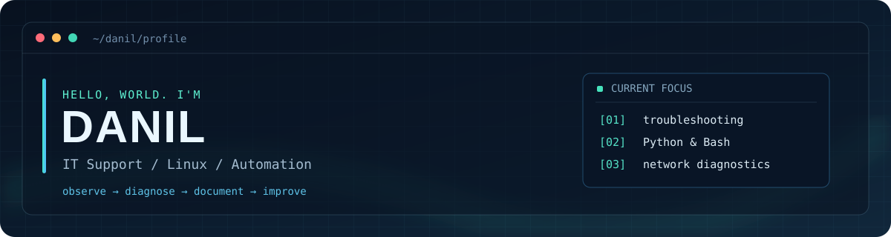

<div align="center">



### Привет! Я Данил 👋

**Начинающий IT-инженер · техническая поддержка · Linux · изучаю DevSecOps**

Учусь разбираться в причинах сбоев, проверять гипотезы и автоматизировать повторяющиеся задачи.  
Ищу возможность развиваться в **IT Support / сопровождении сервисов / Junior Linux** и постепенно осваиваю **DevSecOps** — безопасность инфраструктуры, автоматизацию и практики безопасной разработки.

*Learning troubleshooting and automation, one lab at a time.*

<a href="https://github.com/smadie228/sub"></a>
<a href="https://github.com/smadie228/New_world/tree/main/projects/linux-incident-lab"></a>

</div>

---

### `01 / about_me`

```text
danil@lab:~$ cat focus.txt

> Техническая поддержка и диагностика HTTP / TCP
> Linux, командная строка, Bash и SSH
> Python-скрипты, тесты и понятная документация
> Git, основы сетей и SQL
> Изучаю мониторинг, Active Directory, DevSecOps и безопасность сервисов
```

**Мой подход:** воспроизвести проблему → собрать факты → найти причину → проверить решение → описать результат.

### `02 / featured_projects`

| Проект | Что внутри | Зачем сделал |
|:--|:--|:--|
| 🔎 **[Service Checker](https://github.com/smadie228/sub)** | Python, HTTP/TCP, JSON/JSONL, unit-тесты, QA-чеклист и учебные Jira-сценарии | Учиться диагностировать недоступные сервисы и оформлять результаты проверок |
| 🐧 **[Linux Incident Lab](https://github.com/smadie228/New_world/tree/main/projects/linux-incident-lab)** | Bash, тестовый HTTP-сервис, сценарии 503/timeout, тесты и инструкции | Практиковать базовую диагностику инцидентов на учебном стенде |
| 🧱 **[cub3D](https://github.com/smadie228/cb3d)** | C, raycasting, обработка карты, графика, управление памятью | Практика системного мышления и работы с C в Школе 21 |
| 🧮 **[Функциональное программирование](https://github.com/smadie228/synergy-functional-programming)** | Python, Haskell, лабораторные, тесты, инструкции | Закреплять алгоритмическую базу и разбирать инструменты на практике |

> Проекты учебные. Демонстрационные инциденты и Jira-кейсы не являются реальными обращениями клиентов или опытом работы в production.

### `03 / toolbox`

<div align="center">


</div>

### `04 / currently_learning`

- **DevSecOps:** основы безопасности Linux, управление секретами, анализ зависимостей, CI/CD и принципы безопасной инфраструктуры — изучаю на учебных примерах.
- Диагностика Linux: процессы, логи, права, сетевые подключения и systemd.
- Работа службы поддержки: приоритизация, воспроизведение проблем, эскалация и понятные тикеты.
- Active Directory и инструменты мониторинга — **в процессе изучения**, не заявляю коммерческую практику.
- Небольшие Python/Bash-инструменты, которые можно протестировать и объяснить на собеседовании.

<details>
<summary><b>📂 Другие учебные проекты и база на C</b></summary>

- [ft_printf](https://github.com/smadie228/smadie_printf) — форматирование вывода и вариативные аргументы.
- [libft](https://github.com/smadie228/smadie_LIBFT42) — основные функции стандартной библиотеки C.
- [get_next_line](https://github.com/smadie228/smadie_GNL42) — построчное чтение.
- [push_swap](https://github.com/smadie228/push_swap) — алгоритмы и сортировка.
- [so_long](https://github.com/smadie228/So_Long42) — небольшая 2D-игра на C.

</details>

---

<div align="center">

`learning` · `building` · `documenting`

**Спасибо, что заглянули!**  
[Все репозитории](https://github.com/smadie228?tab=repositories) · [Учебные IT-проекты](https://github.com/smadie228/New_world)

</div>
